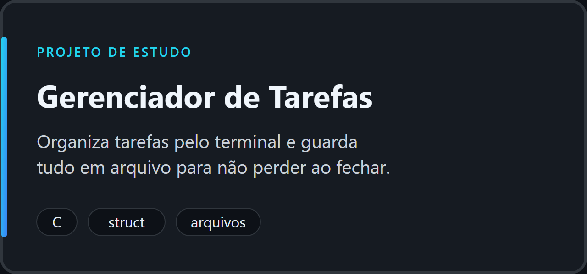
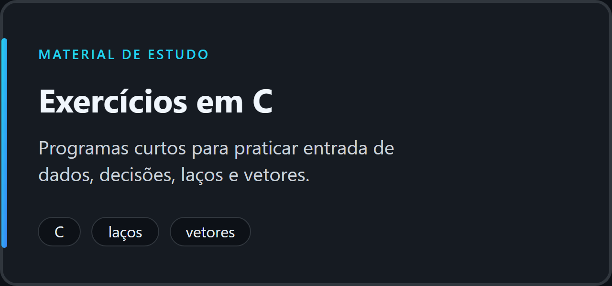

<div align="center">


[**Sobre**](#sobre-mim) · [**Formação**](#formação) · [**Aprendizado**](#o-que-estou-aprendendo) · [**Projetos**](#projetos-em-destaque) · [**Próximos passos**](#próximos-passos) · [**English**](#in-english)

</div>

## Sobre mim

Sou o Gustavo, estudante de Análise e Desenvolvimento de Sistemas na Universidade Cruzeiro do Sul. Estou no começo da minha trajetória em programação e uso o GitHub para organizar o que estudo, registrar minha evolução e buscar minha **primeira oportunidade na área de tecnologia** (estágio ou vaga júnior).

Ainda não tenho experiência profissional em tecnologia. O que posso mostrar aqui é dedicação, organização e projetos pequenos e bem explicados.

## Formação

- **Tecnólogo em Análise e Desenvolvimento de Sistemas**, Universidade Cruzeiro do Sul (em andamento)

## O que estou aprendendo

| Tema | Em que ponto estou |
|---|---|
| **Linguagem C** | Iniciante: entrada e saída, decisões, laços, vetores e arquivos simples |
| **Lógica e algoritmos** | Estudando na disciplina de Algoritmos e Pensamento Computacional |
| **Git e GitHub** | Iniciante: commits, push e organização de repositórios |
| **VS Code e terminal** | Uso diário nos estudos |

Não listo aqui tecnologias que ainda não estudei de verdade. Quando eu avançar, esta tabela muda.

## Projetos em destaque

Os projetos abaixo são **materiais de estudo**. O código foi escrito com a ajuda de uma IA e o README de cada um explica isso. Meu papel é estudar, executar, entender e implementar as melhorias listadas.

<table>
  <tr>
    <td width="50%" valign="top">
      <a href="https://github.com/silvaguh747-oss/gerenciador-de-tarefas-c">
        
      </a>
      <br><b>Problema:</b> manter uma lista de tarefas simples, sem perder os dados ao fechar o programa.
      <br><b>Como:</b> menu no terminal, <code>struct</code> para cada tarefa e gravação em arquivo de texto.
    </td>
    <td width="50%" valign="top">
      <a href="https://github.com/silvaguh747-oss/exercicios-c">
        
      </a>
      <br><b>Problema:</b> praticar os fundamentos de C com programas curtos que dá para refazer.
      <br><b>Como:</b> média de notas, tabuada, maior valor de um vetor e par ou ímpar.
    </td>
  </tr>
</table>

<details>
<summary><b>Como executar os projetos</b></summary>

<br>

Com o compilador GCC instalado, dentro da pasta de cada projeto:

```bash
gcc -Wall -Wextra -o tarefas tarefas.c
./tarefas
```

No PowerShell do Windows, use `.\tarefas.exe`. As instruções completas estão no README de cada repositório.

</details>

<details>
<summary><b>Como eu estudo</b></summary>

<br>

1. Leio e executo o código pronto.
2. Refaço sem consultar.
3. Implemento uma melhoria da lista do README.
4. Faço o commit e registro o que aprendi.

</details>

## Próximos passos

- [ ] Refazer os exercícios de C sem consultar o código
- [ ] Implementar as melhorias do gerenciador de tarefas (prioridade, edição, memória dinâmica)
- [ ] Aprender a dividir um programa em vários arquivos
- [ ] Estudar estruturas de dados básicas
- [ ] Criar um projeto novo, escolhido e planejado por mim

## Contato

Pelo GitHub: [@silvaguh747-oss](https://github.com/silvaguh747-oss)

---

### In English

I'm Gustavo, an Information Systems Analysis and Development student at Cruzeiro do Sul University, just starting out in programming. I'm learning C, algorithms and Git/GitHub, and I'm looking for an internship or junior opportunity. The projects here are learning material, and each README explains what I studied and what I plan to improve. (Basic English; I'm not claiming fluency.)
